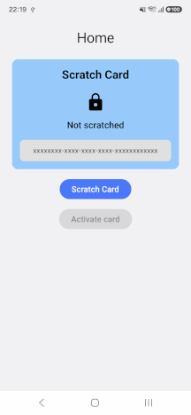
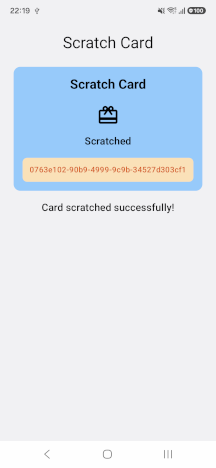
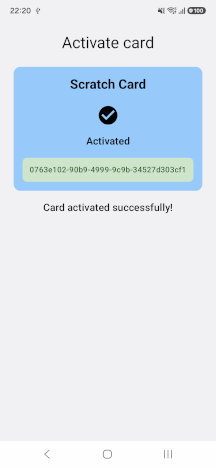

# Scratch Card

A simple Android application demonstrating a scratch card activation flow.

## Screenshots

| Home | Scratch Card | Activation |
|:---:|:---:|:---:|
|  |  |  |
| `home.png` | `scratch-card.png` | `activation.png` |

## Features

- **Home screen** — displays the current scratch card status and provides navigation to the available actions.
- **Scratch card** — simulates scratching a card and reveals a unique code after a short delay.
- **Activation** — submits the revealed code to a backend API and displays the activation result.
- **State management** — handles card state transitions and activation feedback, including loading, success, rejection, and error states.

## Card Lifecycle

The scratch card follows a simple state machine:

`UNSCRATCHED` → `SCRATCHED` → `ACTIVATED`

- **UNSCRATCHED** — the card has not been scratched yet.
- **SCRATCHED** — the card has been scratched and a unique code has been revealed.
- **ACTIVATED** — the card has been successfully activated.

Invalid state transitions are ignored.

## Tech Stack

- Kotlin
- Android
- Jetpack Compose
- Kotlin Coroutines
- ViewModel
- Navigation 3
- Retrofit
- Moshi
- Kotest

## Architecture

The application separates business logic, UI state, and presentation.

- **Domain logic** — represents the scratch card lifecycle and validates state transitions.
- **ViewModel** — coordinates user actions, asynchronous operations, and UI state.
- **Repository** — handles communication with the activation API.
- **Compose UI** — displays the current card status and activation feedback.

## API

The application communicates with a backend API to validate the scratch card activation code.

The activation result depends on the response returned by the API.

## Testing

Unit tests cover the card state transitions, activation logic, and relevant ViewModel behavior.
